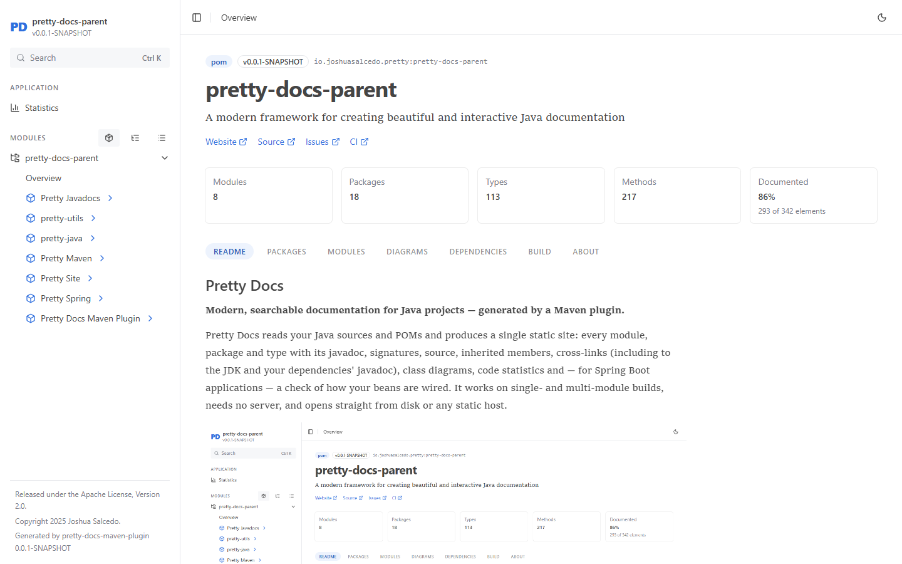
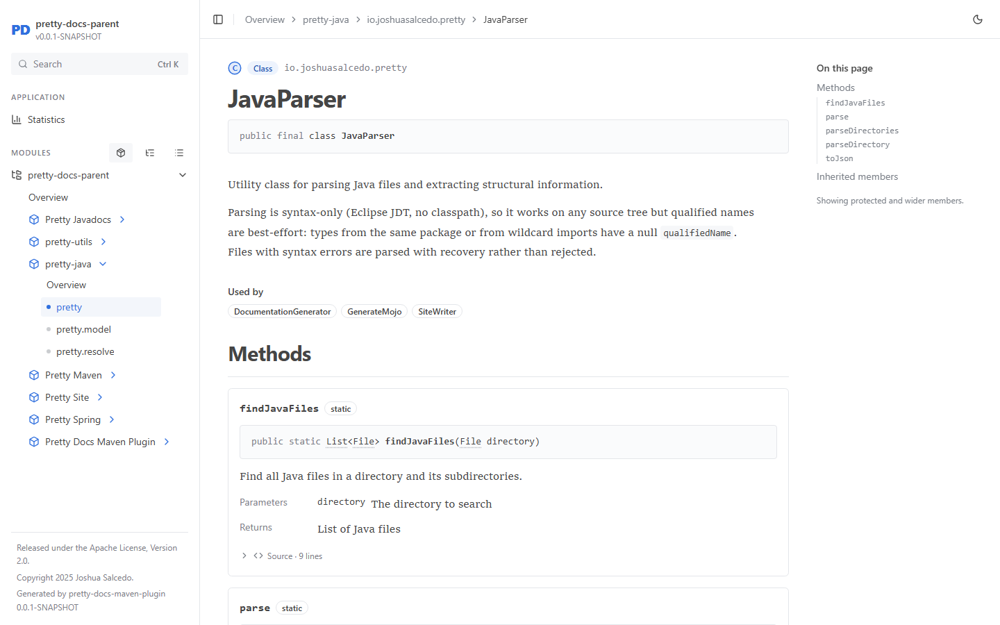
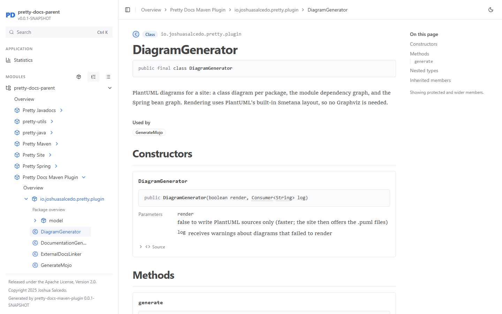
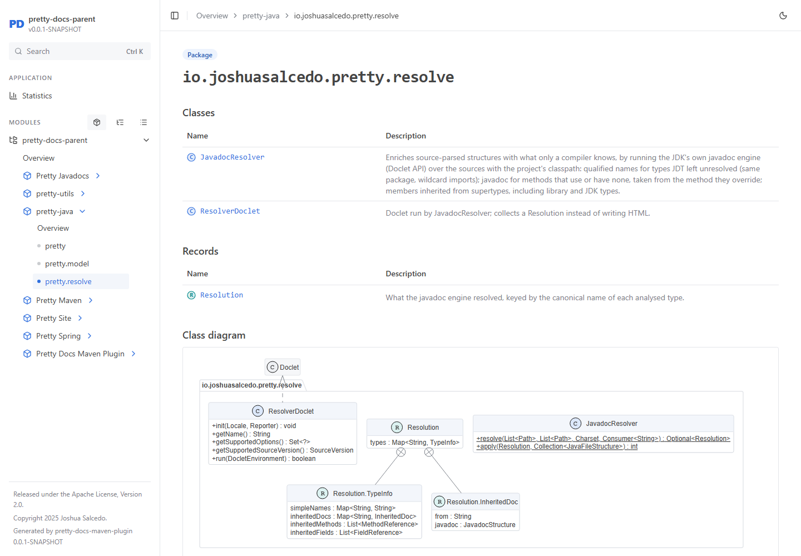
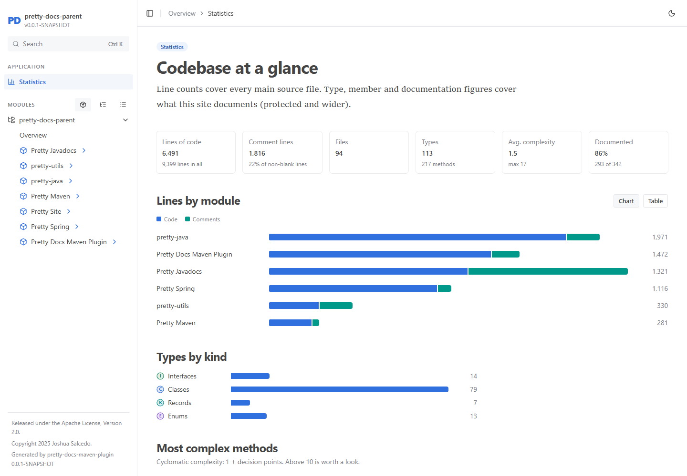
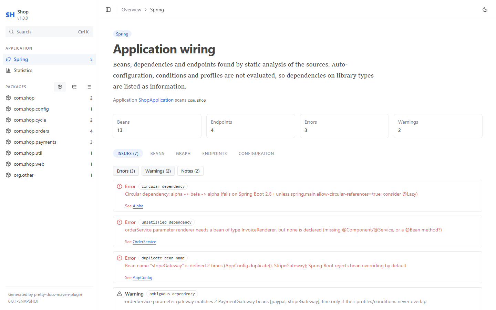
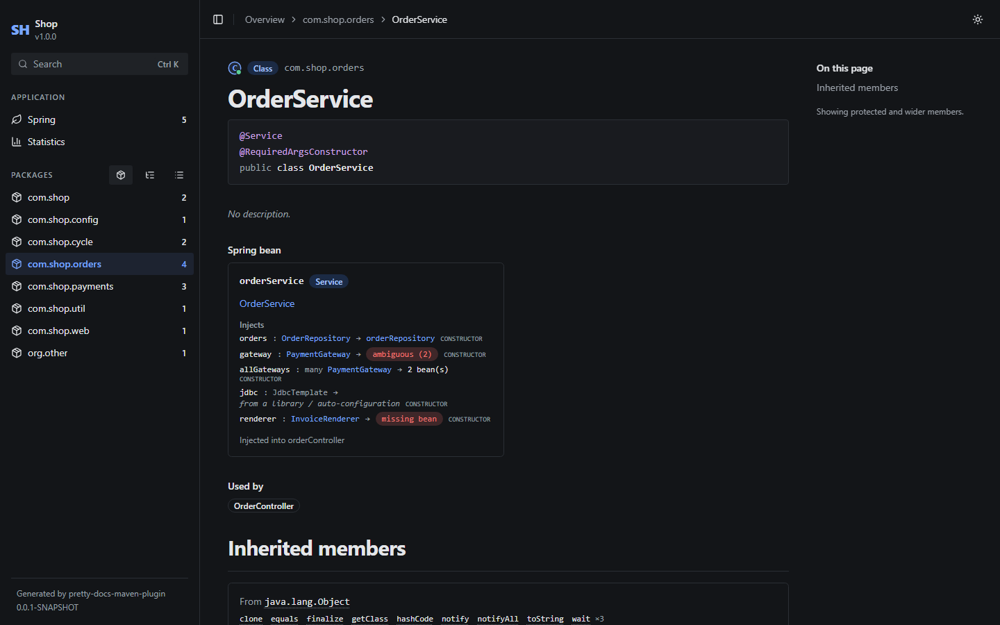

# Pretty Docs

**Modern, searchable documentation for Java projects — generated by a Maven plugin.**

[**See it live**](https://joshuasalcedo-dev.github.io/pretty-docs/): this repository's own documentation,
generated by the plugin and published to GitHub Pages on every push.

Pretty Docs reads your Java sources and POMs and produces a single static site: every module, package and
type with its javadoc, signatures, source, inherited members, cross-links (including to the JDK and your
dependencies' javadoc), class diagrams, code statistics and — for Spring Boot applications — a check of how
your beans are wired. It works on single- and multi-module builds, needs no server, and opens straight from
disk or any static host.



| Type page | Package tree and type icons |
|---|---|
|  |  |
| **Class diagrams (PlantUML)** | **Statistics** |
|  |  |
| **Spring wiring check** | **Spring beans on type pages (dark mode)** |
|  |  |

## What you get

- **Whole build, one site.** Run it from the root of a multi-module project and every module is documented
  together; run it inside a module (or with `-pl`) and only that part is. Modules link to each other.
- **Exact types and inherited docs.** By default the plugin runs the JDK's own javadoc engine (Doclet API)
  against your dependency classpath, so same-package and wildcard-imported types resolve, `{@inheritDoc}`
  is expanded, and members inherited from libraries and the JDK are listed. Nothing has to compile first.
- **Links out.** JDK and dependency types link to their official javadoc (the same `element-list` mechanism
  as `javadoc -link`), cached locally and offline-safe.
- **Readable pages.** Signatures with linked types, javadoc rendered safely, collapsible source with
  VS Code–grade syntax highlighting (Shiki), Ctrl+K search over types, methods, fields, packages, beans and
  endpoints, module README rendering, light and dark mode.
- **Navigation that scales.** Resizable sidebar with three views: packages, a compact package tree with
  types, and an A–Z type list. Language- and framework-aware icons (class, interface, enum, record,
  annotation; Spring bean, JPA entity, exception, test).
- **Diagrams.** PlantUML class diagrams per package, a module dependency graph and a Spring bean graph,
  rendered to SVG in pure Java (no Graphviz), plus the `.puml` sources.
- **Statistics.** Lines of code (code / comment / blank, cloc-style), types by kind, documentation coverage,
  cyclomatic complexity, and the most complex methods and largest types.
- **Spring Boot support.** Beans (stereotypes, `@Bean` methods, Spring Data repositories, configuration
  properties), what each injects — including Lombok-generated constructors — REST endpoints,
  `@ConfigurationProperties` keys, `@Value` placeholders and JPA entities. Wiring problems Spring would hit at
  startup are reported in the site and in the build log: missing and ambiguous dependencies, circular
  dependencies, duplicate bean names, components outside the scanned packages, and more.
- **One context per application.** In a multi-module build each `@SpringBootApplication` (or a project
  annotation carrying it) gets its own context: its module plus the build modules it depends on, what it scans
  and `@Import`s, and the auto-configurations those modules list in `AutoConfiguration.imports` /
  `spring.factories`. `@Profile`, `@ConditionalOnProperty` (against that application's configuration files) and
  `@ConditionalOnMissingBean` / `@ConditionalOnBean` are evaluated, so a bean that backs off is not reported as
  ambiguous. Other conditions are assumed to hold. Issues and beans are tagged with the applications they
  belong to, and the site can filter by application.
- **Configuration files.** `application*.yml` / `.properties` (and `bootstrap*`, in a resource folder or its
  `config/`) are shown highlighted, with every key linked to what reads it: `@ConfigurationProperties`,
  `@Value`, `@ConditionalOnProperty`, `Environment.getProperty` calls, or a library's
  `spring-configuration-metadata.json` (read from the resolved dependencies). Keys nothing reads are flagged,
  with a "did you mean" suggestion for likely typos, and so are required `@Value` placeholders no file sets.
- **TypeScript, as its own tree** (opt-in: `<typescript>true</typescript>` or `-Dpretty-docs.typescript=true`). Every directory with a `tsconfig.json` inside the build (a frontend next to
  the backend, a workspace package) becomes a package of its own, described by its `package.json`. TypeScript
  is kept apart from the Maven modules: it has its own sidebar section and dependency graph, and packages are
  grouped under the npm, yarn, pnpm or bun workspace (`"workspaces"` in `package.json`, or
  `pnpm-workspace.yaml`) that lists them as members. It is read with the
  TypeScript compiler (bundled with the plugin) and its type checker, so you get:
  - classes, interfaces, enums, type aliases, functions (React components included) and exported constants;
  - JSDoc and signatures exactly as written;
  - types linked across files, and a "Used by" list that counts calls, JSX usages and type references.

  Exported declarations are public; the rest is package-private, so the default `protected` visibility
  documents a project's exports. This needs `node` on the PATH and is skipped with a message when there is none.
- **Code quality.** A Quality page, plus a Findings section on each type's page, lists likely bugs from three
  tools. Each finding links to the rule's documentation and to the code.
  - **PMD** reads the Java sources, so no build is needed. It runs a curated set of error-prone,
    best-practice, multithreading, performance and security rules; style rules are left out.
  - **SpotBugs** reads the classes of the last build (`target/classes`): null dereferences, `equals`
    without `hashCode`, unsafe synchronization and more. Modules that were never compiled are skipped.
  - **The TypeScript compiler** reports type errors. Projects without installed `node_modules` get a
    single "run npm install" note instead of a cascade of follow-on errors.

  High-priority findings also appear as build warnings.
- **Assets.** An Assets page (and a tab on each module page) shows the images in the modules' folders: icons,
  logos, `public/`, `assets/`, `static/` and `src-tauri/icons/`, on a checkered, light or dark background.
- **Logo and repository link.** The site header shows the project's logo (a `logo.svg`/`.png` in the usual
  places, or the most logo-like asset) and a link to its GitHub (or other) repository, taken from the POM's
  `<scm>` or the git remote. A `-SNAPSHOT` version is marked as a snapshot.
- **Ignores.** `<ignores>` leaves directories out (Maven modules, TypeScript packages and assets), and so does
  everything your `.gitignore` files ignore.

## Requirements

- JDK 21 or newer (a JDK, not a JRE: the resolved mode uses the JDK's javadoc engine)
- Maven 3.9 or newer
- Node.js is **not** needed, to use or to build the plugin: the site template ships prebuilt inside it. Only
  documenting TypeScript runs `node` (any recent version) when it is on the PATH.

## Quick start

The plugin is not on Maven Central yet. Install it into your local Maven repository once, either from the
[1.2.1 release](https://github.com/joshuasalcedo-dev/pretty-docs/releases/tag/v1.2.1) (unzip
`pretty-docs-1.2.1-maven-repository.zip` into `~/.m2/repository`) or from source:

```shell
git clone git@github.com:joshuasalcedo-dev/pretty-docs.git
cd pretty-docs
mvn install
```

Then, in the root of **any** Maven project:

```shell
mvn io.joshuasalcedo.pretty:pretty-docs-maven-plugin:1.2.1:generate
```

The site is written to `target/pretty-docs/`. The build log tells you how to open it:

```text
[INFO] Documented 113 types in 8 module(s) (resolved mode, 7 external javadoc site(s) linked)
[INFO] Please run one of these commands to serve the static site:
[INFO]   mvn io.joshuasalcedo.pretty:pretty-docs-maven-plugin:1.2.1:serve
[INFO]   npx serve "target/pretty-docs" -l 4400
[INFO]   python -m http.server 4400 -d "target/pretty-docs"
[INFO] Then open: http://localhost:4400/
```

You can also open `target/pretty-docs/index.html` directly in a browser — the site works from `file://`.

## Using it in your build

Add the plugin to your root POM so the command gets shorter and the settings live with the project:

```xml
<build>
  <plugins>
    <plugin>
      <groupId>io.joshuasalcedo.pretty</groupId>
      <artifactId>pretty-docs-maven-plugin</artifactId>
      <version>1.2.1</version>
      <configuration>
        <visibility>protected</visibility>
        <excludeModules>
          <excludeModule>integration-tests</excludeModule>
        </excludeModules>
        <links>
          <link>https://docs.spring.io/spring-framework/docs/current/javadoc-api/</link>
        </links>
        <ignores>
          <ignore>legacy</ignore>
          <ignore>frameworks/*/examples</ignore>
        </ignores>
        <typescriptProjects>
          <project>applications/web</project>
        </typescriptProjects>
      </configuration>
    </plugin>
  </plugins>
</build>
```

```shell
mvn pretty-docs:generate      # works once the plugin is declared (or with the plugin group configured)
mvn pretty-docs:serve
```

To build the docs with every `mvn package`, bind the goal on the root project only (it is an aggregator):

```xml
<executions>
  <execution>
    <id>docs</id>
    <phase>package</phase>
    <goals><goal>generate</goal></goals>
    <inherited>false</inherited>
  </execution>
</executions>
```

### Goals and parameters

`pretty-docs:generate` — documents every module of the current build.

| Parameter | Property | Default | |
|---|---|---|---|
| `outputDirectory` | `pretty-docs.outputDirectory` | `${project.build.directory}/pretty-docs` | Replaced on each run (only if it was created by Pretty Docs). |
| `visibility` | `pretty-docs.visibility` | `protected` | Lowest access level shown: `public`, `protected`, `package`, `private`. |
| `mode` | `pretty-docs.mode` | `resolved` | `resolved` uses the JDK javadoc engine for exact types and inherited docs (falls back to `source` if it can't run); `source` parses sources only. |
| `includeMethodBodies` | `pretty-docs.includeMethodBodies` | `true` | Include method source for "view source". |
| `includeTestSources` | `pretty-docs.includeTestSources` | `false` | Also document test sources. |
| `title` | `pretty-docs.title` | `${project.name}` | Site title. |
| `excludeModules` | `pretty-docs.excludeModules` | — | artifactIds to leave out. |
| `linkJdk` | `pretty-docs.linkJdk` | `true` | Link JDK types to the Java SE API docs (version from `maven.compiler.release`). |
| `linkDependencies` | `pretty-docs.linkDependencies` | `true` | Link dependency types to javadoc.io. |
| `links` | — | — | Extra javadoc sites, checked first (like `javadoc -link`). |
| `diagrams` | `pretty-docs.diagrams` | `true` | Generate PlantUML diagrams. |
| `renderDiagrams` | `pretty-docs.renderDiagrams` | `true` | Render diagrams to SVG; `false` writes only `.puml`. |
| `port` | `pretty-docs.port` | `4400` | Port shown in the "how to view" message. |
| `typescript` | `pretty-docs.typescript` | `false` | Document TypeScript projects (directories with a `tsconfig.json`) found in the modules' directories; needs `node` on the PATH. Off by default. |
| `typescriptExcludes` | `pretty-docs.typescriptExcludes` | | Directories to leave out of the TypeScript search only, relative to the root module, e.g. `legacy,examples`. `node_modules`, `target`, `dist`, `build` and hidden directories are always skipped. |
| `typescriptProjects` | `pretty-docs.typescriptProjects` | all found | Document only these TypeScript projects (directories with a `tsconfig.json`, relative to the root module). |
| `typescriptWorkspaces` | `pretty-docs.typescriptWorkspaces` | `true` | Group packages under their workspace; `false` lists each package on its own. |
| `typescriptTypeCheck` | `pretty-docs.typescriptTypeCheck` | `true` | Report TypeScript compiler errors on the Quality page. |
| `typescriptIncludeTests` | `pretty-docs.typescriptIncludeTests` | as `includeTestSources` | Document `*.test.ts`, `*.spec.ts` and `__tests__`. |
| `node` | `pretty-docs.node` | `node` on the PATH | The node executable for the TypeScript analysis. |
| `ignores` | `pretty-docs.ignores` | — | Directories to leave out entirely, relative to the root module: `legacy`, `frameworks/*/examples`, `**/fixtures`. A bare name matches anywhere. |
| `gitignore` | `pretty-docs.gitignore` | `true` | Also leave out what the repository's `.gitignore` files ignore. |
| `assets` | `pretty-docs.assets` | `true` | Show the modules' images (icons, logos, `public/`, `static/`) on an Assets page; files over 1 MB and more than 500 per module are left out. |
| `logo` | `pretty-docs.logo` | found | Header logo, relative to the root module. |
| `repositoryUrl` | `pretty-docs.repositoryUrl` | from `<scm>` or the git remote | Repository link in the header. |
| `quality` | `pretty-docs.quality` | `true` | Code quality findings (PMD, SpotBugs, TypeScript compiler) in the site and the build log. |
| `pmd` | `pretty-docs.pmd` | `true` | Run PMD on the Java sources. |
| `spotbugs` | `pretty-docs.spotbugs` | `true` | Run SpotBugs on the classes of the last build; modules without `target/classes` are skipped. |
| `skip` | `pretty-docs.skip` | `false` | Skip the goal. |

`pretty-docs:serve` — serves the generated site with the JDK's built-in HTTP server until Ctrl+C.
Parameters: `outputDirectory`, `port` (`pretty-docs.port`, default `4400`), `host` (`pretty-docs.host`,
default `localhost`; use `0.0.0.0` to allow other machines).

### What gets written

```text
target/pretty-docs/
├── index.html      the site (one self-contained file: app, styles, fonts)
├── docs-data.js    an outline of your project (modules, types, signatures), loaded by index.html
├── modules/        each module's full sources, loaded when one of its pages is opened
├── docs.json       all the data as one JSON file, for your own tooling
└── diagrams/       *.puml sources and their rendered *.svg
```

The split keeps large builds quick to open: the site starts from the outline and fetches a module's data
(through a script tag, so it works from `file://` too) only when you visit it.

## Deploying the docs

The output is plain static files, so any static host works: copy `target/pretty-docs/` to GitHub Pages,
Netlify, S3, an nginx folder, or an internal file share. Paths are relative and routing uses the URL hash, so
the site works under any sub-path.

### GitHub Pages

This repository publishes its own documentation with
[`.github/workflows/docs.yml`](.github/workflows/docs.yml) on every push to `main`. To use it, enable
**Settings → Pages → Source: GitHub Actions** once. For your own project, the job is:

```yaml
- uses: actions/setup-java@v5
  with: { distribution: temurin, java-version: 21, cache: maven }
- run: mvn -B -ntp io.joshuasalcedo.pretty:pretty-docs-maven-plugin:1.2.1:generate
- uses: actions/upload-pages-artifact@v3
  with: { path: target/pretty-docs }
# then actions/deploy-pages@v4 in a job with `pages: write` and `id-token: write`
```

(Until the plugin is published to a repository your CI can reach, build and install it in the same job, as
this repository's workflow does.)

## How it works

```text
sources ──► pretty-java (Eclipse JDT) ──► [resolved mode: JDK javadoc engine via a Doclet] ──┐
POMs ─────► pretty-maven ───────────────────────────────────────────────────────────────────┤
                                                    pretty-spring (bean wiring analysis) ◄──┤
                                                                                            ▼
                         pretty-docs-maven-plugin: filter by visibility, statistics, README,
                         external javadoc links, PlantUML diagrams ──► docs.json + docs-data.js
                                                                                            ▼
                                     pretty-site (React + shadcn/ui, one HTML file) renders it
```

| Module | What it does |
|---|---|
| `pretty-java` | Parses Java sources into a structural model (types, members, javadoc, comments, calls, line counts); `JavadocResolver` adds compiler-exact names and inherited docs. |
| `pretty-maven` | Reads POM metadata and module trees. |
| `pretty-spring` | Static Spring / Spring Boot analysis: beans, injection, endpoints, configuration properties, wiring checks. |
| `pretty-quality` | Runs PMD (sources) and SpotBugs (compiled classes) in-process and collects their findings; the curated PMD rules are in `pmd-rules.xml`. |
| `pretty-ts` | Reads TypeScript projects into the same model: a plain-JavaScript analyzer (`analyzer.cjs`) on the TypeScript compiler API, run by the user's `node`; the compiler ships as the `org.webjars.npm:typescript` WebJar. |
| `pretty-site` | Source of the site template (Vite, React, Tailwind, shadcn/ui); not a Maven module. Its build is committed into the plugin's resources. |
| `pretty-docs-maven-plugin` | The `generate` and `serve` goals that tie it together. |
| `pretty-utils` | Small JSON / file / Git helpers. |
| `pretty-javadocs` | The original prototype, kept for reference; nothing depends on it. |

## Developing Pretty Docs

```shell
mvn clean install                               # everything (no Node.js needed)
mvn install -pl pretty-java -am                 # one module and what it needs
mvn -pl pretty-spring test -Dtest=SpringAnalyzerTest#reportsWiringProblems

# Try it on this repository
mvn io.joshuasalcedo.pretty:pretty-docs-maven-plugin:1.2.1:generate
mvn io.joshuasalcedo.pretty:pretty-docs-maven-plugin:1.2.1:serve
```

Working on the site template (Node.js 20+): generate docs for any project, copy its
`target/pretty-docs/docs-data.js` and `modules/` folder to `pretty-site/public/`, then run `npm run dev` in `pretty-site/`. When
done, `npm run build` writes the template into `pretty-docs-maven-plugin/src/main/resources/pretty-site/`;
commit that file with your change (CI checks it matches the source).

GPG signing only runs in the `central` profile (Maven Central requires it), so local builds need no GPG.

### Publishing the artifacts

`mvn package -P clean-deploy-all` runs [`scripts/clean-deploy-all.sh`](scripts/clean-deploy-all.sh), which
deploys to GitHub Packages, the Nexus repository and Maven Central in turn. Each profile also works on its own,
e.g. `mvn clean deploy -P nexus`.

## License

Apache License, Version 2.0.
